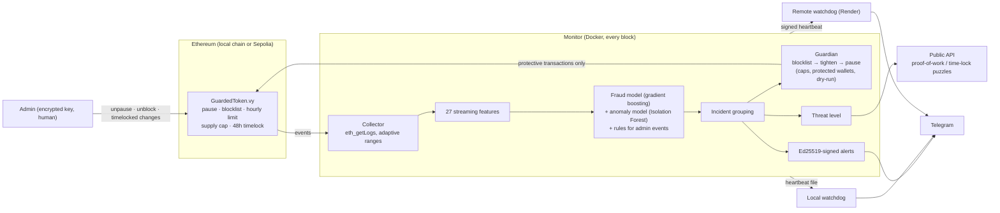

# Guarded Token: an AI-guarded ERC-20 token with automated detection and response

| | |
|---|---|
| **Author** | *IBRAHIM BARO YIDI*, *[MOSCOW TECHICAL UNIVERSITY OF COMMUNICATION AND INFORMATICS, Masters in Quamtum Communication, first year]* |
| **Contact** | *[Baroisyidi@gmail.com]* |
| **Version** | 1.0.0 (15 October 2026) |
| **Status** | Working prototype, deployed on the Sepolia public test network |
| **License** | MIT for this project's code (see [License](#license)); third-party libraries keep their own licenses |
| **External resources** | Ethereum Sepolia testnet, Alchemy RPC (free tier), Telegram Bot API, Render (remote watchdog) |
| **Live deployment** | Token `0x94257114D1bAD555BbD6f7112C6D8D28b213Fb28` on [Sepolia Etherscan](https://sepolia.etherscan.io/address/0x94257114D1bAD555BbD6f7112C6D8D28b213Fb28) |

## Abstract

Fraud on token networks usually succeeds because it is noticed too late:
by the time a person reads an alert, a stolen wallet has been emptied.
This project explores whether a machine-learning monitor, combined with
narrowly limited on-chain powers, can detect and **contain** such attacks
automatically, within seconds, without giving the AI the power to cause
irreversible harm.

The system has four layers. (1) An ERC-20 token written in Vyper with
built-in safety controls: pause, blocklist, an hourly per-wallet transfer
limit, a supply cap and a 48-hour timelock on administrative changes. (2) A
monitor that reads every block, scores every transfer and sends
Ed25519-signed alerts to Telegram, with local and remote watchdogs that
report if it goes silent. (3) Two models trained on simulated traffic: a
gradient-boosted fraud classifier and an Isolation Forest anomaly detector
over 27 streaming features, with plain-language explanations and incident
grouping. (4) A guardian that responds with escalating, reversible actions
(blocklist, then a tighter limit, then pause), under safety caps, and a
proof-of-work / time-lock puzzle gate that makes flooding the public API
expensive.

On an unseen 28-day simulation the models caught **99 of 99 attacks at 0.9
false alarms per day**, against 9 of 99 and 106 false alarms per day for
hand-written rules. In a red-team drill the guardian stopped all five attack
types without blocking any innocent wallet. Deployed on the public Sepolia
network, it stopped a live stolen-key drill after **2 payments, in 18
seconds**, keeping 80% of the funds. The results come from simulated
traffic and a testnet; the [limitations](#known-limitations) and
[safe-use rules](#safety-ethics-and-responsible-use) are stated below.

**Keywords:** blockchain security, fraud detection, anomaly detection,
gradient boosting, Isolation Forest, ERC-20, smart contracts, automated
incident response, client puzzles, time-lock puzzles, Ed25519, Ethereum
Sepolia.

**Contents:** [Quick start (Docker)](#option-a-docker-recommended-on-windows) ·
[Architecture](#architecture) · [Phase 1](#phase-1-the-token) ·
[Phase 2](#phase-2-the-monitor) · [Phase 3 (AI models)](#phase-3-trained-detection-models) ·
[Phase 4 (active defence)](#phase-4-active-defence) ·
[Going public (Sepolia)](#going-public-the-sepolia-test-network) ·
[Results](#results-summary) · [Project layout](#project-layout) ·
[Libraries, models and data](#libraries-models-and-data) · [License](#license) ·
[Limitations](#known-limitations) · [Safety and ethics](#safety-ethics-and-responsible-use) ·
[Authorship](#authorship-and-ai-assistance) · [References](#references)

## About this README

A learning-prototype ERC-20 token with emergency controls (Phase 1), an
AI-guard monitor that watches it every second and sends signed alerts to
Telegram (Phase 2), trained detection models that catch attacks the
hand-written rules miss (Phase 3), and an active defence that stops attacks
on-chain and makes API attackers pay in computing time (Phase 4). Everything
runs on a **local blockchain** on your computer: no wallet, no real ETH, no
faucet. When you are ready, the same guard runs on the public **Sepolia test
network** (see "Going public", near the end), still free.

> Not audited. Local chain / testnet use only.

There are two ways to run it. **Option A (Docker)** is easiest on Windows.
**Option B (Python)** suits Linux, macOS or WSL.

---

## Option A: Docker (recommended on Windows)

Docker runs everything in ready-made containers, so you don't install
Python or any libraries yourself.

### 1. Install Docker Desktop (once)

1. Download **Docker Desktop for Windows** from
   [docker.com](https://www.docker.com/products/docker-desktop/) and run the
   installer. Keep the **"Use WSL 2"** option ticked.
2. Restart your computer when asked.
3. Open Docker Desktop and wait until it shows **Engine running**. If it
   asks to install or update WSL, say yes and let it finish.

Docker Desktop must be open whenever you use the commands below.

### 2. Open the project in a terminal

1. Right-click `guarded-token.zip` and choose **Extract All**.
2. Open the extracted folders until you see the one that contains
   `docker-compose.yml`.
3. Right-click an empty area of that folder and choose **Open in Terminal**.
   On Windows 10, hold Shift while you right-click and choose
   **Open PowerShell window here**.

### 3. Build and test (first build takes about 5 to 10 minutes; it also trains the models)

```powershell
docker compose build
docker compose run --rm app
```

You should see **93 passed**. Then watch the walkthrough demos:

```powershell
docker compose run --rm app ape run demo        # Phase 1: the contract's defences
docker compose run --rm app ape run live_demo   # Phase 2: monitor + alerts
docker compose run --rm app ape run ml_demo     # Phase 3+4: caught by the models, stopped by the guardian
docker compose run --rm app ape run redteam     # Phase 4: every attack, with and without the guardian (~5 min)
docker compose run --rm app python -m defense.flood_demo   # Phase 4: what puzzles cost attackers
```

### 4. Add your Telegram bot (optional)

```powershell
copy .env.example .env
notepad .env
```

Fill in `TELEGRAM_BOT_TOKEN` and `TELEGRAM_CHAT_IDS` (see "Set up the
Telegram bot" below), save, and close Notepad. Without them, alerts print
in the terminal instead.

### 5. Run the whole system

```powershell
docker compose up -d                 # chain + deploy + monitor + guardian + watchdog + API
docker compose logs -f monitor       # watch alerts live (Ctrl+C stops watching only)
```

The guardian is **on** in the Docker stack: it really blocklists wallets and
tightens the limit on the local chain. To only report what it would do, put
`GUARDIAN_MODE=dry-run` in `.env` (or `off` for alerts only) and run
`docker compose up -d` again.

Open a **second** terminal in the same folder and play an attack:

```powershell
docker compose run --rm attack          # a fast drain
docker compose run --rm attack fanout   # a stealthy fan-out (Phase 3)
```

Alerts appear in the first terminal and in Telegram within about a second,
followed by an `[ACTION]` message when the guardian steps in. The attack
script then shows `[stopped]` for every transfer the guardian blocked.

The guardian's actions stay in force (as on a real chain): after one attack
the hourly limit is tightened, so a second attack may be refused outright.
For a fresh start: `docker compose down` then `docker compose up -d`.

Check the public API and its puzzles from PowerShell:

```powershell
curl.exe http://localhost:8080/status
docker compose run --rm --no-deps app python -m defense.client http://api:8080 0x14dC79964da2C08b23698B3D3cc7Ca32193d9955 --times 2
```

Try the watchdog:

```powershell
docker compose stop monitor          # about 30 seconds later: MONITOR DOWN
docker compose start monitor         # then: RECOVERED
```

When you're done:

```powershell
docker compose down
```

The local chain starts fresh each time, but the monitor's signing key is
kept, so its public key stays the same.

### Useful Docker commands

| Command | What it does |
|---|---|
| `docker compose ps -a` | show which services are running |
| `docker compose logs monitor` | all monitor output, including its public key |
| `docker compose logs watchdog` | watchdog messages |
| `docker compose up -d --build` | rebuild after you change any code |
| `docker compose run --rm app python -m monitor.verify <public_key>` | check an alert's signature (paste it, then press Enter and Ctrl+D) |
| `docker compose logs monitor \| Select-String ACTION` | the guardian's actions (PowerShell) |
| `docker compose run --rm app tail -n 5 /data/alerts.jsonl` | last 5 entries of the alert log (every alert, sent or grouped) |
| `docker compose down -v` | stop and also delete stored keys, data and the alert log |

### If something goes wrong

- **"Cannot connect to the Docker daemon" / "pipe ... not found":** Docker
  Desktop isn't running. Open it and wait for *Engine running*.
- **"port is already allocated" for 8545:** another program uses that port.
  In `docker-compose.yml`, change `127.0.0.1:8545:8545` to
  `127.0.0.1:8546:8545`.
- **"No deployed token found"** when running `attack`: start the stack first
  with `docker compose up -d`.
- Anything else: copy the error and ask for help.

---

## Option B: Python directly (Linux, macOS or WSL)

Requires Python 3.10+.

```bash
python3 -m venv .venv
source .venv/bin/activate
pip install -r requirements.txt
cp .env.example .env               # then fill in Telegram details (optional)
python -m ml.train                 # train the Phase 3 models (about a minute)

ape test             # 93 tests: contract, monitor, models, incidents, guardian, puzzles, Sepolia tools
ape run demo         # Phase 1: attack and the contract's response
ape run live_demo    # Phase 2: same attack, with the monitor sending alerts
ape run ml_demo      # Phase 3+4: an attack the rules miss, caught and stopped
ape run redteam      # Phase 4: every attack type, guardian off vs on (~5 min)
python -m defense.flood_demo   # Phase 4: puzzle costs, honest user vs attacker
```

Without Telegram settings, alerts print in the terminal. With them, they
arrive in your Telegram chat.

---

## Phase 1: the token

| Control | Who can use it | Speed |
|---|---|---|
| `pause()` | admin or guardian | instant |
| `block_address(addr)` | admin or guardian | instant |
| `tighten_limit(amount)` | admin or guardian (lower only) | instant |
| `unpause()`, `unblock_address()`, `revoke_guardian()` | admin only | instant |
| `propose_limit` / `execute_limit` (raise or remove limit) | admin only | 48-hour timelock |
| `propose_guardian` / `execute_guardian` | admin only | 48-hour timelock |
| `propose_admin` / `accept_admin` | admin proposes, new admin accepts | 48-hour timelock |
| `mint(to, amount)` | admin only, never above `MAX_SUPPLY` | instant |

The guardian (the AI service's key) can only take **protective,
reversible** actions. If its key is stolen, the worst an attacker can do is
pause the token, and the admin can cut it off with `revoke_guardian()`.

- Every non-admin wallet can send at most `transfer_limit` tokens per hour.
- Blocklisted addresses cannot send tokens or spend allowances.
- Every action emits an event for the monitor to watch.

## Phase 2: the monitor

The monitor polls the chain every second, decodes the token's events,
scores each one from 0 to 100 and sends anything 40 or above to Telegram.

| Score | Severity | What happens |
|---|---|---|
| 0–39 | LOG | written to `alerts.jsonl` only |
| 40–69 | WARNING | Telegram message |
| 70–89 | ALERT | Telegram message |
| 90–100 | CRITICAL | Telegram message |

**Detection rules** (in `monitor/rules.py`; Phase 3 adds machine learning):

| Rule | Fires when | Score |
|---|---|---|
| `drain_pace` | a wallet sends 80%+ of the hourly limit within an hour | 72 |
| `fresh_wallet_dump` | a wallet funded < 10 min ago has sent half of what it got | 60 |
| `burst` | 3+ transfers from one wallet within 60 seconds | 55 |
| `large_transfer` | one transfer is 50%+ of the hourly limit | 45 |
| `mint_near_cap` | supply reaches 90% of the cap | 65 |
| admin events | pause, blocklist, limit or role changes | 40–92 |

When several rules match one transfer, the top score is raised by 8 per
extra rule, so an attack escalates as evidence builds (e.g. 60, then 88).

**Safety features**
- **Signed alerts:** every message ends with an Ed25519 `sig:` line. Check
  one with `python -m monitor.verify <public_key>` and paste the message.
  The public key is printed when the monitor starts; save it somewhere safe.
- **Grouping:** repeats of the same alert within 5 minutes are grouped
  unless the score gets worse.
- **Heartbeat + watchdog:** the monitor rewrites a heartbeat file every
  poll and sends "alive" messages every 10 minutes. A separate watchdog
  process (with its own signing key) sends **MONITOR DOWN** if heartbeats
  stop.
- **Chat allowlist:** only chat IDs in `TELEGRAM_CHAT_IDS` get messages.

### Set up the Telegram bot

1. In Telegram, message **@BotFather**, send `/newbot`, and follow the
   prompts. Copy the token it gives you into `TELEGRAM_BOT_TOKEN` in `.env`.
2. Send any message to your new bot (or add it to a group and post there).
3. Open `https://api.telegram.org/bot<YOUR_TOKEN>/getUpdates` in a browser
   and find `"chat":{"id": ...}`. Put that number in `TELEGRAM_CHAT_IDS`
   (group IDs start with `-`).
4. Run `ape run live_demo` (Docker: `docker compose run --rm app ape run live_demo`);
   the alerts should arrive in Telegram.

Keep the bot token secret: anyone with it can send messages as your bot.

### Run it for real without Docker (Option B: separate terminals)

With Docker, `docker compose up -d` does all of this for you (Option A, step 5).

`live_demo` runs everything in one process. To run the monitor the way it
would run in production, start a local node that keeps running:

```bash
# Terminal 1: a local node with Ape's default test accounts, chain id 1337
npx ganache --chain.chainId 1337 --wallet.totalAccounts 40 \
  --wallet.mnemonic "test test test test test test test test test test test junk"
# (or, with Foundry installed: anvil --chain-id 1337)

# Terminal 2: deploy, then copy the printed TOKEN_ADDRESS into .env
ape run deploy --network ethereum:local:node

# Terminal 3: the monitor
python -m monitor

# Terminal 4: the watchdog
python -m monitor.watchdog

# Terminal 2 again: play an attack and watch the alerts arrive
ape run attack_sim --network ethereum:local:node
ATTACK=fanout ape run attack_sim --network ethereum:local:node
```

Stop the monitor with Ctrl+C and the watchdog reports MONITOR DOWN within
about 30 seconds.

## Phase 3: trained detection models

The monitor now scores every transfer with two models trained on simulated
traffic, instead of the four hand-written rules:

| Model | Learns from | Good at |
|---|---|---|
| **Fraud model** (gradient-boosted trees) | normal **and** labeled attack traffic | attack patterns it has seen |
| **Anomaly model** (Isolation Forest) | normal traffic only | behaviour that is simply very unusual |

The higher of the two scores is used. Each alert says **why** in plain
English, for example "paid 11 brand-new wallets in the last hour" or
"hourly outflow is 26 times this wallet's normal". The Phase 2 rules still
score admin events (pause, role changes) and now act as inputs to the fraud
model for transfers.

### How it was trained and tested

`python -m ml.train` (run automatically by the Docker build):

1. **Simulates** weeks of token traffic: 400+ users, exchanges, merchants,
   market makers, payroll, airdrops, plus five attack types: *drain*,
   *fan-out*, *low-and-slow*, *sybil farm* and *wash trading*. Normal traffic
   deliberately includes look-alikes: wallet migrations, new users spending
   their first funds, exchanges near the hourly limit.
2. Turns each transfer into 27 **features** using only past events (wallet
   age, payments to new wallets, per-wallet baselines, circular flows, rule
   flags), exactly as the live monitor sees them.
3. Trains on one simulation, sets score thresholds on a second, and tests on
   a third that the models never saw.
4. Writes the scorecard to **`ml/report.md`** and the model to `models/`.

### Results on the unseen test simulation (28 days, 99 attacks)

| Detector | Attacks caught (score 70+) | False alarms per day (70+) | False-alarm messages per day (40+) |
|---|---|---|---|
| Phase 2 rules | 9 / 99 | 106 | 180 |
| Phase 3 models | 99 / 99 | 0.9 | 3.7 |

The rules mostly fire on busy exchanges and market makers, and miss
attacks designed to stay under their thresholds. Two honest caveats:

- **These numbers come from simulated data.** Real traffic will differ;
  retrain on real data before trusting the models on a live token.
- **New attack types are harder.** When the fraud model is retrained
  *without* an attack type and tested on it, it still catches most incidents,
  but flags far fewer of their individual transfers (for example 14% of a
  "low and slow" attack's transfers, versus 83% once it has seen that type).
  See the "Unseen attack types" table in `ml/report.md`.

### Incidents: one attack, a handful of messages

Transfer alerts that involve the same wallets are grouped into one
**incident**, so a 12-wallet fan-out is one story instead of 18 separate
alerts:

| Message | When |
|---|---|
| `Incident #1 opened` | the first alert, with full details |
| `Incident #1 update` | severity rises, or every 10 minutes while new alerts arrive: counts, wallets, amounts, latest reasons |
| `[CLOSED] Incident #1` | after 2 hours with no new alerts, with a summary |
| `Incident #1 REOPENED` | linked activity resumes within 24 hours (patient attackers) |

Wallets are linked by the money flow: the sending wallet, a brand-new
receiving wallet, and new wallets the sender paid in the last hour.
Established wallets such as exchanges are never used as links, so two
unrelated attacks that cash out at the same exchange stay separate.
Admin events (pause, blocklist, role changes) are always sent straight away.
Every individual alert is still written to the alert log.

### Switching detectors

Set `DETECTOR` in `.env`: `auto` (default: models if `models/guard_model.joblib`
exists, otherwise rules), `ml`, or `rules`. If the model file is missing or
broken, the monitor falls back to the rules rather than stopping. Model
files are Python pickles, which run code when loaded, so only use models
you trained yourself.

## Phase 4: active defence

### The guardian acts on incidents

The monitor now holds the **guardian key** and responds to incidents on its
own, climbing a ladder:

| Step | When | What the guardian does |
|---|---|---|
| 1. Blocklist | incident reaches ALERT (70+) with two alerts, or one at 90+ | blocklists the wallets in the incident, so they can no longer send |
| 2. Tighten | incident reaches CRITICAL (90+) | lowers the hourly limit for everyone (to 10% of the original) |
| 3. Pause | the attack keeps going after steps 1 and 2, or the blocklist budget runs out | pauses the whole token |

Each step is reported once in Telegram as an `[ACTION]` message. All of them
are **protective and reversible**, the only kind of action the contract lets
the guardian take. Only the admin can undo them: `unblock_address()`,
`unpause()`, and `propose_limit()` followed by a 48-hour timelock.

**Safety limits**, so a bug or a false alarm cannot run wild:
- the admin, the guardian and anything in `PROTECTED_WALLETS` (exchanges, treasury) are never blocklisted
- at most 30 blocklistings per hour and 25 per incident
- `GUARDIAN_MODE`: `on`, `dry-run` (report what it *would* do) or `off`
- on start, the monitor silently reads the token's history (`START_BLOCK`), so
  established wallets are never mistaken for new ones. Without this, a
  restarted monitor could blocklist innocent users (found and fixed during
  testing; there is a test for it).
- if an action fails, an `[ACTION FAILED]` message is sent and monitoring continues

### Red-team drill (`ape run redteam`)

Every attack type, on-chain, on a fresh token with 20 users and an exchange
trading normally before and during the attack. Full table in
**`reports/redteam.md`**:

| Attack | Escaped, alerts only | Escaped, guardian on | Frozen, guardian on | Innocent users blocklisted |
|---|---|---|---|---|
| drain | 8,026 GTT | **0** | 8,026 GTT | 0 |
| fan-out | 4,960 GTT | **0** | 852 GTT | 0 |
| low and slow | 14,435 GTT | **0** | 4,539 GTT | 0 |
| sybil farm | 2,600 GTT | **0** | 2,600 GTT | 0 |
| wash trading | 21,000 GTT fake volume | **1,400** fake volume | 6,000 GTT | 0 |

The token never had to be paused. The cost: 8 of 623 normal transfers
failed, all because the tightened hourly limit also applies to the busy
exchange, until the admin raises it again.

### Puzzles: make attackers pay (`defense/`)

A small public API (`http://localhost:8080`) serves token balances. Before
answering, it may demand a **computational puzzle**, harder when the monitor
reports a higher threat level and much harder for clients that flood it or
send wrong answers:

| Threat level | Normal client | Suspicious client |
|---|---|---|
| normal | none | proof of work, 16 bits |
| elevated | proof of work, 12 bits | proof of work, 20 bits |
| high | proof of work, 16 bits | proof of work, 22 bits |
| critical | proof of work, 18 bits | **time-lock, 10 seconds** |

- **Proof of work (Hashcash):** find a nonce so that SHA-256(challenge + nonce)
  starts with N zero bits; each extra bit doubles the cost, and the server
  checks with one hash.
- **Time-lock (Rivest-Shamir-Wagner):** compute x^(2^t) mod N for a 2048-bit
  RSA modulus. Without the secret factors this means t squarings **one after
  another**, so extra computers do not help. The server knows the factors and
  checks instantly.
- Puzzles are signed (HMAC) with an expiry, and each can be used only once.

`python -m defense.flood_demo` measures the cost on your machine. On mine,
10,000 requests at the critical level cost an honest user about **30 minutes**
of CPU time and a flooding attacker about **28 hours**.

## Going public: the Sepolia test network

Everything so far ran on a private chain inside Docker. Sepolia is a real,
public Ethereum test network: anyone can see your token on Etherscan, blocks
come every 12 seconds, and fees are paid in **Sepolia ETH, which is free and
has no value**. Nothing here costs money.

| | Local stack | Sepolia stack |
|---|---|---|
| Compose file | `docker-compose.yml` | `docker-compose.sepolia.yml` |
| Settings | `.env` | `.env.sepolia` |
| Chain | Ganache in Docker, wiped on restart | public, permanent |
| Wallets | public test accounts | **your own new wallets**, encrypted in `secrets/` |
| Fees | none | free test ETH from a faucet |
| Watchdogs | local | local + optional remote one on Render |

> **Safety rules.** Use brand-new wallets made by the tools below, never one
> that holds real crypto. Never share the `secrets/` folder, `.env.sepolia`
> or a private key (not in chat, not with me). The tools refuse to run on
> Ethereum mainnet and other real-money networks.

**Shortcut.** The commands are long, so define a short name in PowerShell
first (do this in every new PowerShell window, inside the project folder):

```powershell
function gts { docker compose -f docker-compose.sepolia.yml @args }
```

Now `gts up -d` means `docker compose -f docker-compose.sepolia.yml up -d`.

### Step 1: get a Sepolia RPC URL (free)

The monitor needs a gateway to the network. Sign up at
[alchemy.com](https://www.alchemy.com), create an app, choose **Ethereum →
Sepolia**, and copy its HTTPS URL (it looks like
`https://eth-sepolia.g.alchemy.com/v2/abc123...`). Infura works too.

### Step 2: create `.env.sepolia`

```powershell
copy .env.sepolia.example .env.sepolia
notepad .env.sepolia
```

Fill in:
- `SEPOLIA_RPC_URL`: the URL from step 1.
- `TELEGRAM_BOT_TOKEN` and `TELEGRAM_CHAT_IDS`: the same values as in `.env`.
- `GUARDIAN_KEYSTORE_PASSWORD`: make up a strong password (12 or more
  characters). The monitor runs unattended, so it reads this to unlock the
  guardian wallet.
- Leave `ADMIN_KEYSTORE_PASSWORD` **empty**. You will be asked for the admin
  password each time, so it is never stored on disk.

On a free Alchemy plan the defaults (`POLL_SECONDS=6`, `LOG_BLOCK_RANGE=10`)
use about two-thirds of the monthly allowance when running 24/7. On Infura,
set `POLL_SECONDS=12`.

### Step 3: build and create your two wallets

```powershell
gts build
gts run --rm tools keys new admin
gts run --rm tools keys new guardian
```

The admin key asks you to choose a password; the guardian key uses the one
from `.env.sepolia`. Each command prints the wallet's address. The key
files are saved, encrypted, in the `secrets` folder next to this README.

**Back up the `secrets` folder** (e.g. to a USB stick) and remember the
admin password. Without them, control of the token is lost for good; there
is no "forgot password" on a blockchain.

### Step 4: get free test ETH

Copy the **admin** address and paste it into a Sepolia faucet, for example:
- Google Cloud Web3 faucet: https://cloud.google.com/application/web3/faucet/ethereum/sepolia
- Sepolia PoW faucet (your browser "mines" for a few minutes): https://sepolia-faucet.pk910.de
- Alchemy faucet: https://www.alchemy.com/faucets/ethereum-sepolia

Faucet rules change often; if one asks for a mainnet balance, try another.
**0.05 Sepolia ETH is plenty** for weeks of testing (deploying costs well
under 0.01).

### Step 5: deploy the token

```powershell
gts run --rm tools deploy-public
```

It shows the network, both wallets and their balances, then asks you to
type `yes` and enter the admin password. When it finishes, it prints your
token's address and an Etherscan link. The address and start block are
saved in the `deployment` folder. Then give the guardian a little ETH, so it
can pay for its protective actions:

```powershell
gts run --rm tools admin fund guardian 0.01
gts run --rm tools admin status
```

### Step 6: start the guard

```powershell
gts up -d
gts logs -f monitor
```

You should see `Guardian: on (acts as 0x...)`, then `[ONLINE] Monitor
started` on Telegram. If you see a `[WARNING] Guardian problem` message, it
says what to fix (usually: no ETH yet). The puzzle-protected API runs at
http://localhost:8080/status as before.

Note the line `Alert signing public key: ...` near the top of the log;
step 7 needs it. (`Ctrl+C` stops following the log; the monitor keeps
running.)

### Step 7 (optional): a remote watchdog on Render

The local watchdog cannot warn you if your whole computer switches off. The
remote watchdog lives on Render: the monitor sends it a signed "I'm alive"
every 30 seconds, and you get `[MONITOR DOWN]` on Telegram if they stop for
2 minutes. It also warns you if the monitor is alive but stuck on an old
block (for example, because the RPC provider is down).

**Before you start: Render's free plan has a limit.** It gives 750 free
hours a month per workspace, shared by all your free services. A watchdog
receiving heartbeats is awake around the clock (about 744 hours a month).
If your existing bot is also a free service, the two together can run out,
and then Render suspends **all** your free services, including the bot,
until next month. Choose one:

- **A. Its own free service** (simplest). Fine if your bot is on a paid
  plan (paid services do not use the free hours), or if you only run the
  monitor for a few hours a day: the watchdog only uses hours while
  heartbeats arrive, and sleeps 15 minutes after they stop.
- **B. Inside your existing bot's service.** No extra hours: your bot is
  already awake. `render_watchdog/README.md` shows the few lines to add if
  your bot is written in Python.

For A: put this project on GitHub (the `.gitignore` already keeps
`secrets/`, `deployment/` and `.env.sepolia` out), then in Render choose
**New → Web Service** and:

| Setting | Value |
|---|---|
| Root directory | `render_watchdog` |
| Build command | `pip install -r requirements.txt` |
| Start command | `python app.py` |
| Environment | `TELEGRAM_BOT_TOKEN`, `TELEGRAM_CHAT_IDS` (same as your bot), `MONITOR_PUBLIC_KEY` (from step 6) |

It only *sends* messages with your bot's token; it never changes the bot's
webhook, so your bot keeps working. When it is live, add its address to
`.env.sepolia` and restart the monitor:

```
REMOTE_WATCHDOG_URL=https://<your-service>.onrender.com/heartbeat
```
```powershell
gts up -d
```

You get `[ONLINE] Remote watchdog receiving heartbeats` on Telegram. Test it
with `gts stop monitor`: within about 2 minutes, both watchdogs alert. Then
run `gts start monitor` and both send `[RECOVERED]`. Opening
`https://<your-service>.onrender.com/` in a browser shows its status.

### Step 8: see it in MetaMask and on Etherscan

- Open the Etherscan link from step 5: every transfer, block and guardian
  action is public there.
- In MetaMask, turn on **Show test networks** and switch to **Sepolia**.
  Then use **Import account → JSON file**, choose `secrets/admin.json` and
  enter the admin password. Finally, **Import tokens** with your token
  address: you will see 100,000 GTT.

### Step 9: the fire drill

This simulates a stolen key, live on Sepolia, so you can watch the guard
work end to end:

```powershell
gts run --rm tools drill
```

The drill does the following:
1. It creates a throwaway "victim" wallet and gives it 0.003 ETH and
   4,000 GTT.
2. A "thief" then pays the GTT out to brand-new wallets, one payment at a
   time.
3. It stops as soon as the guardian blocks the victim or pauses the token.

On my test chain the guardian stopped the thief after 2 to 3 payments. On
Sepolia, expect 30 to 60 seconds, because blocks are slower. Telegram shows
the incident and the `[ACTION]` messages; leftover ETH goes back to the
admin wallet. Example output:

```
STOPPED after 2 payment(s), 5s: victim wallet blocklisted.
GTT that got out: 824.61 of 4,000; still in the victim wallet: 3,175.39
```

Afterwards the guardian has also tightened the hourly limit for everyone.
Restoring it goes through the 48-hour timelock on purpose:

```powershell
gts run --rm tools admin status
gts run --rm tools admin propose-limit 10000     # now
gts run --rm tools admin execute-limit           # 48 hours later
```

### Admin commands

```powershell
gts run --rm tools admin status                  # roles, balances, pause, limit, pending changes
gts run --rm tools admin check 0xADDRESS         # blocklisted? balance?
gts run --rm tools admin send 0xADDRESS 250      # give someone GTT to test with
gts run --rm tools admin unblock 0xADDRESS       # undo a wrong block
gts run --rm tools admin unpause                 # undo a pause
gts run --rm tools admin fund guardian 0.01      # top up the guardian's ETH
gts run --rm tools admin revoke-guardian         # emergency: guardian key stolen
gts run --rm tools keys list                     # your wallet addresses
```

Stop everything with `gts down`. Your token stays on Sepolia; `gts up -d`
resumes watching it, and the monitor first reads what happened while it
was off (silently, so it doesn't alert on old events).

### If something goes wrong (Sepolia)

| You see | What it means / what to do |
|---|---|
| `gts : The term 'gts' is not recognized` | New PowerShell window: run the `function gts ...` line again (or save it in your profile, see the shortcut above). |
| `Cannot reach the RPC provider (... name resolution ...)` | Your computer cannot look up Alchemy's address (DNS). Usually temporary; if it keeps happening, set Windows DNS to `1.1.1.1` and `8.8.8.8` (Win+R, `ncpa.cpl`, your connection, Properties, IPv4) and restart Docker Desktop. The monitor keeps retrying on its own. |
| `Cannot reach the RPC provider (... 401 ...)` / `Must be authenticated` | The key in `SEPOLIA_RPC_URL` is wrong or was regenerated: copy the Sepolia URL from Alchemy again, then `gts up -d --force-recreate`. |
| `execute-limit`: `Not yet: the 48-hour timelock ends in ...` | Working as designed; run it again after that time. `admin status` shows the countdown. |
| `Wrong password for .../admin.json` | Retype carefully (capital letters matter). |
| `port is already allocated` | The local stack is still running: `docker compose down`. |

Error messages hide your Alchemy key and Telegram token automatically, but
still check anything before you paste it somewhere: a key looks like
`alch_...` or the part after `/v2/`.

### Without Docker (Option B)

The same tools run directly: `python -m tools.keys new admin`,
`python -m tools.deploy_public`, `python -m tools.admin status`,
`python -m tools.sepolia_drill`. For the monitor, set `RPC_URL`,
`TOKEN_ADDRESS`, `START_BLOCK` (from `deployment/`), `GUARDIAN_KEYSTORE=secrets/guardian.json`,
`GUARDIAN_KEYSTORE_PASSWORD`, `POLL_SECONDS=6` and `LOG_BLOCK_RANGE=10`,
then run `python -m monitor`.

## Architecture



**Design principles.** The AI acts automatically only through the
**guardian** role, which the contract restricts to protective, reversible
actions: it can block, tighten and pause, but never mint, move funds, unpause
or unblock. Undoing anything needs the human **admin**, and changes that
weaken protection wait 48 hours. Alerts and heartbeats are signed, so a
forged "all clear" is detectable. Each layer assumes the one before it can
fail: the contract limits damage even if the monitor is down, and the
watchdogs report when it is.

**Data flow per block.** The collector reads the token's events, each
transfer becomes a feature vector using only past data (as a live system
must), both models score it, the highest score is used, and related alerts
are grouped into one incident. The guardian then decides whether to act,
under its safety caps. The threat level feeds the API's puzzle difficulty.

## Results summary

| Experiment | Setup | Result |
|---|---|---|
| Detection on unseen data | 28-day simulation, 99 attacks of 5 types | Models: 99/99 caught at 0.9 false alarms/day. Rules: 9/99 at 106/day |
| Generalisation to unseen attack types | Retrain without one type, test on it | Most incidents still caught; fewer transfers flagged (e.g. 14% vs 83% for low-and-slow) |
| Red-team drill (`ape run redteam`) | 5 attack types against the live guardian | 0 GTT escaped in all 5 (vs 2,600–14,435 GTT without the guardian); 0 innocent wallets blocked |
| Puzzle cost (`python -m defense.flood_demo`) | 10,000 requests at the critical level | Honest client ≈ 30 min of CPU; flooding attacker ≈ 28 h |
| Live Sepolia drill (`tools.sepolia_drill`) | Stolen-key fan-out on the public testnet | Stopped after 2 payments in 18 s; 80% of funds kept |
| Test suite | `ape test` | 93 tests passing |

Full details: `ml/report.md` (models) and `reports/redteam.md` (red team).
Every number above can be reproduced with the commands shown in this README;
the simulations use fixed random seeds.

## Project layout

```
contracts/GuardedToken.vy      the token and its safety controls
monitor/chain.py               polls the chain every second
monitor/rules.py               detection rules and scores
monitor/alerts.py              alert format and severity bands
monitor/notify.py              Telegram sender, grouping, alert log
monitor/signing.py             Ed25519 alert signatures
monitor/watchdog.py            independent "monitor down" alarm
monitor/verify.py              check an alert's signature
scripts/demo.py                Phase 1 walkthrough
scripts/live_demo.py           Phase 2 walkthrough (single process)
scripts/deploy.py              deploy to a running local node
scripts/attack_sim.py          attacks against a running local node (drain, fanout)
scripts/ml_demo.py             Phase 3: rules vs models on a fan-out attack
ml/simulate.py                 traffic simulator (normal users + 5 attack types)
ml/features.py                 27 streaming features + plain-English reasons
ml/train.py                    trains, calibrates and scores the models
ml/report.md                   the scorecard
monitor/ml_detector.py         uses the models inside the live monitor
monitor/incidents.py           groups related alerts into incidents
monitor/guardian.py            Phase 4: the guardian's escalation ladder and safety limits
scripts/redteam.py             Phase 4: red-team drill -> reports/redteam.md
defense/puzzles.py             proof-of-work and time-lock puzzles
defense/gate.py                who must solve which puzzle (threat level, client behaviour)
defense/api.py                 the puzzle-protected public API
defense/client.py              a client that solves puzzles automatically
defense/flood_demo.py          measures puzzle costs: honest user vs attacker
tools/keys.py                  Sepolia: create / import encrypted wallets (secrets/)
tools/deploy_public.py         Sepolia: deploy the token (refuses real-money networks)
tools/admin.py                 Sepolia: status, fund, unblock, unpause, timelocked changes
tools/sepolia_drill.py         Sepolia: live stolen-key fire drill
render_watchdog/               remote watchdog web service for Render
models/                        trained model (created by python -m ml.train)
tests/                         93 tests
Dockerfile                     container image (Option A)
docker-compose.yml             local stack: chain, deploy, monitor, watchdog, API, tools
docker-compose.sepolia.yml     Sepolia stack: monitor, watchdog, API, tools
docker/entrypoint.py           what each container runs
.env.example                   settings template (local)
.env.sepolia.example           settings template (Sepolia)
LICENSE                        MIT license for this project
```

## Libraries, models and data

**Third-party libraries** (installed from `requirements.txt` and the Docker
base image; versions pinned where it matters):

| Library | Version | Used for | License |
|---|---|---|---|
| [Vyper](https://github.com/vyperlang/vyper) | 0.4.3 | smart-contract language and compiler | Apache-2.0 |
| [Ape](https://github.com/ApeWorX/ape) (`eth-ape`, `ape-vyper`) | 0.8.52 / 0.8.12 | build, test and deploy framework | Apache-2.0 |
| [web3.py](https://github.com/ethereum/web3.py) | 7.x | blockchain access | MIT |
| [eth-account](https://github.com/ethereum/eth-account) | 0.13.x | transaction signing, encrypted keystores | MIT |
| [scikit-learn](https://scikit-learn.org) | 1.9.1 | gradient boosting, Isolation Forest | BSD-3-Clause |
| [NumPy](https://numpy.org) / [SciPy](https://scipy.org) / [joblib](https://joblib.readthedocs.io) | 2.x / 1.x / 1.x | numerics, model files | BSD-3-Clause |
| [PyNaCl](https://github.com/pyca/pynacl) | 1.5+ | Ed25519 signatures for alerts and heartbeats | Apache-2.0 |
| [requests](https://requests.readthedocs.io) | 2.x | Telegram Bot API, heartbeats | Apache-2.0 |
| [python-dotenv](https://github.com/theskumar/python-dotenv) | 1.x | settings files | BSD-3-Clause |
| [pytest](https://pytest.org) | 8.x | tests | MIT |
| [Ganache](https://github.com/trufflesuite/ganache) (Docker image) | 7.9.2 | local test blockchain | MIT |
| Python (Docker image `python:3.12-slim`) | 3.12 | runtime | PSF License |

**Models.** Both models are trained by this project (`python -m ml.train`,
run automatically by the Docker build) and saved to `models/`, which is not
committed: they are rebuilt from the code, so the repository contains no
opaque binary models. No pre-trained or third-party models are used.

**Data.** All training and test data is **synthetic**, generated by
`ml/simulate.py` with fixed seeds (train 101, validation 202, test 303). No
real users' transactions or personal data are used. The live Sepolia
deployment only processes this project's own test token, whose wallets were
created for the project.

**External services.** Ethereum Sepolia (public testnet), an Ethereum RPC
provider such as Alchemy (free tier), the Telegram Bot API for alerts, and
optionally Render for the remote watchdog. Each needs your own account or
key; none is included in this repository.

## License

This project's own code, documentation and generated models are released
under the **MIT License**: see [`LICENSE`](LICENSE). Third-party libraries
keep their own licenses (table above); all are permissive (MIT, BSD,
Apache-2.0), allowing use and modification with attribution. The synthetic
datasets are generated by this project's code and covered by the same MIT
License.

## Known limitations

- **Trained on simulated traffic:** see Phase 3 above. Retrain on real
  traffic before relying on the models.
- **Events only:** the monitor sees confirmed transactions. Pending
  (mempool) transactions and rejected attempts are not watched yet.
- **Frozen is not recovered:** the guardian freezes stolen funds in
  blocklisted wallets, but the contract has no way to return them, and the
  victim's own wallet is frozen too (its key is presumed stolen, so
  unblocking it would also hand control back to the thief). A real token
  would need an admin "recover to a new address" function, which is a
  serious trust trade-off: it lets the admin move anyone's frozen funds.
- **The guardian key is a hot key** on the monitor machine. Its powers are
  limited to protective actions, and the admin can revoke it instantly
  (`revoke_guardian()`), but on a public network keep it separate from
  everything else. Its password sits in `.env.sepolia` so the monitor can
  start unattended. The admin key is only unlocked when you type its
  password.
- **The guardian reacts after the fact:** it acts on confirmed blocks, so a
  thief's transactions that are already in flight still land. In the drill,
  2 or 3 payments get out before the block. Faster reaction would need
  mempool watching or private transaction relays.
- **Free plans are metered:** Alchemy, Infura and Render free tiers have
  monthly or daily limits (see "Going public"). Running 24/7 on free plans
  is possible, but it uses a large share of those limits.
- **Tightening affects everyone:** see the red-team note on the exchange.
- **Puzzles protect the API, not the chain:** on-chain transfers are limited
  by the contract and the guardian. Clients are identified by IP address, so
  users behind one shared address share a reputation.
- **Static analysis:** Slither currently fails on Vyper 0.4 output, so
  the contract relies on tests and manual review.
- **Self-contained ERC-20:** rebuild on an audited library such as
  snekmate before any real deployment; use a multisig admin.
- **Classic ERC-20 `approve` race:** set an allowance to 0 before changing it.
- **Scope:** the original plan also included phishing-site, malware and
  smart-contract vulnerability detectors. They are not implemented in this
  version; the AI part covers fraud and anomaly detection on token transfers.
- **Restart time grows:** after a restart the monitor re-reads the token's
  history from the deployment block (silently, to rebuild its picture of
  known wallets). On a free RPC plan this takes longer as the chain grows.

## Safety, ethics and responsible use

**Purpose.** This is a defensive research prototype: it detects and contains
attacks on a token its operator controls. It is not a tool for attacking
other systems.

**Dual-use components and how they are limited.** The repository contains
attack *simulators* (`ml/simulate.py`, `scripts/attack_sim.py`,
`scripts/redteam.py`, `tools/sepolia_drill.py`), because a detector cannot be
trained or tested without examples of attacks. They are limited as follows:

- They only generate transfers of **this project's own test token**, between
  wallets the operator creates. They contain no exploits, malware, phishing
  content or techniques against third-party contracts.
- The public-network tools **refuse to run on Ethereum mainnet** and other
  real-money networks (`tools/chain.py`, `MAINNETS`), and the project is
  documented as testnet-only.
- The live drill uses a throwaway wallet funded by the operator, and returns
  leftover test ETH afterwards.

**Limits on the AI's own power.** Automated decisions can be wrong, so the
system is built so that a wrong decision is cheap to undo:

- The guardian can only take **protective, reversible** actions (blocklist,
  tighten, pause). It cannot move, mint or burn funds.
- It needs **corroboration** (two strong alerts, or one very strong one)
  before blocking, has **caps** (at most 30 blocks per hour and 25 wallets per
  incident), never blocks **protected wallets**, and supports **dry-run** mode,
  which reports what it would do without doing it.
- Every action is announced on Telegram with instructions for undoing it.
  Only the human admin can unblock or unpause, and weakening protections waits
  48 hours, so a stolen key cannot quietly disable the safeguards.
- Alerts include **plain-language reasons**, so a person can check why the
  model acted (interpretability), and the false-alarm rate was calibrated
  against a fixed budget.

**Fairness and side effects.** Tightening the hourly limit affects every
holder, not only the attacker; the red-team report measures this (8 normal
transfers were delayed in the drill). Blocklisting is a centralised power:
anyone running a token like this should tell its users that the power exists
and how it is governed.

**Security practices in this repository.** No keys, tokens or personal data
are committed (`.gitignore` excludes `secrets/`, `deployment/` and `.env`
files). Wallet keys are stored encrypted (Ethereum keystore v3: scrypt +
AES). Error messages hide RPC keys and bot tokens automatically
(`monitor/redact.py`). Alerts and heartbeats are signed with Ed25519, and
forged or replayed heartbeats are rejected.

**Safe-use rules.** Use only on test networks, with fresh wallets that hold
no real value. Never commit `.env` files or the `secrets/` folder. Before
any real-money use, the contract needs an independent audit, a multisig
admin, retraining on real traffic, and a legal review: token issuance is
regulated in many countries.

## Authorship and AI assistance

*[Edit this section so it accurately describes your own contribution.]*

The project was conceived, specified and directed by the author, who chose
the design (token on an existing chain, Python stack, testnet-only scope),
ran and verified every phase on their own machine, deployed it to Sepolia,
operated the live drills and integrated the remote watchdog with an existing
Telegram bot. Much of the source code and documentation was written with the
help of an AI coding assistant (Anthropic's Claude), working from the
author's requirements and test results. All results reported here were
produced by running the code.

## References

1. F. Vogelsteller, V. Buterin. *EIP-20: Token Standard.* Ethereum Improvement Proposals, 2015.
2. G. Wood. *Ethereum: A Secure Decentralised Generalised Transaction Ledger* (Yellow Paper).
3. Vyper documentation. https://docs.vyperlang.org
4. F. T. Liu, K. M. Ting, Z.-H. Zhou. *Isolation Forest.* Proc. IEEE ICDM, 2008.
5. J. H. Friedman. *Greedy Function Approximation: A Gradient Boosting Machine.* Annals of Statistics, 29(5), 2001.
6. G. Ke et al. *LightGBM: A Highly Efficient Gradient Boosting Decision Tree.* NeurIPS, 2017 (the histogram method behind scikit-learn's HistGradientBoostingClassifier).
7. F. Pedregosa et al. *Scikit-learn: Machine Learning in Python.* JMLR, 12, 2011.
8. C. Dwork, M. Naor. *Pricing via Processing or Combatting Junk Mail.* CRYPTO, 1992.
9. A. Back. *Hashcash: A Denial of Service Counter-Measure.* 2002.
10. R. L. Rivest, A. Shamir, D. A. Wagner. *Time-lock Puzzles and Timed-release Crypto.* MIT/LCS/TR-684, 1996.
11. D. J. Bernstein, N. Duif, T. Lange, P. Schwabe, B.-Y. Yang. *High-speed High-security Signatures.* Journal of Cryptographic Engineering, 2(2), 2012 (Ed25519).
12. Ethereum Foundation. *Web3 Secret Storage Definition* (keystore v3).
13. Telegram. *Bot API.* https://core.telegram.org/bots/api
